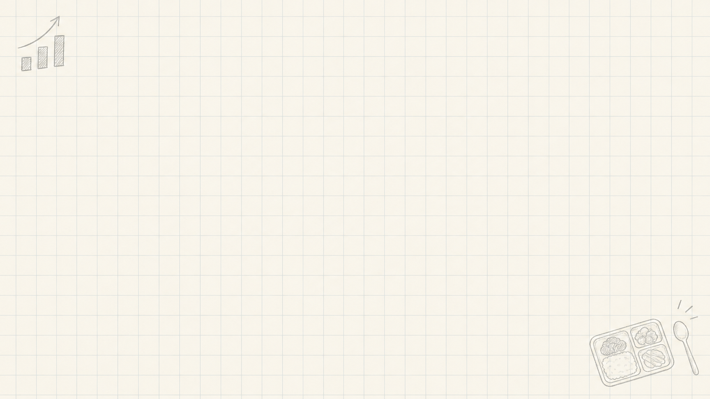

<!-- _class: cover -->
<!-- _paginate: false -->

## Copilot app의 알려지지 않은 기능 두 가지

# Canvas와 Automation

(feat. 급식배틀 앱)

<!-- 만지고, 맡기고, 판단은 사람이 -->

commit/co | 2026-10-22

유저스틴 | 수석 디벨로퍼 아드보캇 | GitHub |  [@justinyoo](https://linkedin.com/in/justinyoo)

---

<!-- _class: ask -->

# AI에게 일을 시킬 때, 뭐가 불편했나요?

---

## 자주 듣는 두 가지 불편

- 결과물이 채팅 밖에 있다 <i class="fa-solid fa-arrow-right" aria-hidden="true"></i> 화면을 계속 오간다
- 같은 일을 매번 시킨다 <i class="fa-solid fa-arrow-right" aria-hidden="true"></i> 내가 계속 붙어 있어야 한다

---

## Canvas

### 같이 보며 고치는 화면

- 결과물을 AI와 같은 화면에 띄워 두고 함께 고치는 작업 공간
- **예** 웹 페이지, 표, 슬라이드, PR
- **언제** 눈으로 확인하며 여러 번 고쳐야 할 때

---

## Automation

### 맡겨 두는 일

- 프롬프트와 일정을 저장해 두면 정해진 때 알아서 실행
- **예** 매일 아침 브리핑, 매주 문서 점검
- **언제** 반복되고, 결과는 나중에 봐도 될 때

---

<!-- _class: duo -->

> **Canvas**
> 내가 화면 앞에 있을 때

> **Automation**
> 내가 자리에 없을 때

---

## 오늘의 무대, 급식배틀

- 두 학교의 점심 급식을 비교하는 웹 앱
- 교육청 공개 급식 데이터 <i class="fa-solid fa-arrow-right" aria-hidden="true"></i> AI 에이전트 분석 <i class="fa-solid fa-arrow-right" aria-hidden="true"></i> 점수
- 오늘은 이 앱을 **한동안 돌보지 못한 상태**에서 다시 열어 봅니다

---

<!-- _class: demo -->

# 급식배틀 앱 둘러보기

Browser Canvas

---

<!-- _class: rubric -->

## 급식은 어떻게 채점할까?

- 영양/건강성 **35**
- 식재료 품질/안전성 **25**
- 메뉴 다양성/기호도 **25**
- 지속가능성/가격 가치 **15**

영역별 5점 척도 <i class="fa-solid fa-arrow-right" aria-hidden="true"></i> 가중치로 환산해 100점 만점

---

<!-- _class: demo -->

# 가중치를 바꾸면 승자도 바뀔까?

Excel Canvas  여러분이 고른 학교 두 곳으로

---

<!-- _class: numbers -->

## 두 달 만에 다시 열어 보니

- **20** 쌓인 의존성 업데이트 PR
- **4** 서로 다른 실패 원인
- **0** 8월 이후 main CI 실행 횟수

발표 준비 시점 기준

<!-- 발표 직전에 숫자를 다시 확인 (Dependabot 상태 고정 여부에 따라 바뀜) -->

---

<!-- _class: punch -->

## 뭐부터 봐야 하지?

- 하나씩 열어 보면 반나절
- 그냥 다 머지하면 위험
- 오늘은 **맡기고, 같이 보고, 판단은 내가**

---

<!-- _class: demo -->

# 출근하면 준비된 브리핑

Automation  매일 오전 9시  PR 20개 중 오늘 볼 3개

[Automation 만들기 <i class="fa-solid fa-arrow-up-right-from-square" aria-hidden="true"></i>](https://github.com/copilot/app/launch?open=ghapp%3A%2F%2Fautomations%2Fnew%3Fname%3DDependabot%2520%25EC%2595%2584%25EC%25B9%25A8%2520%25EB%25B8%258C%25EB%25A6%25AC%25ED%2595%2591%26trigger%3Ddaily%26time%3D09%253A00%26prompt%3D%252Fdependabot-briefing%2520%25EC%2597%25B4%25EB%25A6%25B0%2520Dependabot%2520PR%25EC%259D%2584%2520%25ED%259B%2591%25EC%2596%25B4%25EB%25B3%25B4%25EA%25B3%25A0%2520%25EC%2598%25A4%25EB%258A%2598%2520%25EB%25B3%25BC%25203%25EA%25B0%2580%25EC%25A7%2580%25EB%25A5%25BC%2520%25EA%25B3%25A8%25EB%259D%25BC%2520%25EC%25A4%2598)

<!--
① 링크를 눌러 채워진 생성 화면을 보여 주고 저장하지 않고 닫기 (30초)
② 미리 만들어 둔 Automation의 지난 실행 결과
③ ▶로 지금 실행
지시 내용은 저장소의 skill(/dependabot-briefing)에 있다는 점을 한 줄로 언급
-->

---

<!-- _class: demo -->

# 20개 PR, 한 화면에서 결정

Dependabot 관제탑  #81을 골라 "Copilot에게 맡기기"

<!-- 정체는 17번에서 공개하므로 "직접 만든", "커스텀"이라는 말을 쓰지 않음 -->

---

<!-- _class: demo -->

# #81은 왜 깨졌을까?

PR Canvas  diff와 CI 로그로 근거 확인

<!-- PR Canvas의 CI 링크는 외부 브라우저로 열림. 로그는 관제탑 #81 카드의 Python 실패 링크를 클릭하거나 "#81 CI 로그 앱 안에서 열어 줘"로 앱 안 Browser Canvas에서 엶 -->

---

<!-- _class: demo -->

# 깨진 CI, 고친 PR까지

Automation  사람이 고르고, Automation이 고치고  Draft PR까지만 만들고

[Automation 만들기 <i class="fa-solid fa-arrow-up-right-from-square" aria-hidden="true"></i>](https://github.com/copilot/app/launch?open=ghapp%3A%2F%2Fautomations%2Fnew%3Fname%3DDependabot%2520%25EC%2588%2598%25EC%25A0%2595%2520Draft%2520PR%26trigger%3Ddaily%26time%3D10%253A00%26prompt%3D%252Fdependabot-fix%2520%25EA%25B4%2580%25EC%25A0%259C%25ED%2583%2591%25EC%2597%2590%25EC%2584%259C%2520%25EC%2588%2598%25EC%25A0%2595%2520%25ED%2595%2584%25EC%259A%2594%25EB%25A1%259C%2520%25EB%25B6%2584%25EB%25A5%2598%25EB%2590%259C%2520Dependabot%2520PR%25EC%259D%2584%2520%25EA%25B3%25A0%25EC%25B3%2590%25EC%2584%259C%2520Draft%2520PR%25EB%25A1%259C%2520%25EC%2598%25AC%25EB%25A0%25A4%2520%25EC%25A4%2598)

<!--
① 링크를 눌러 채워진 생성 화면을 보여 주고 저장하지 않고 닫기 (30초)
② 14에서 #81을 "수정 필요"로 옮긴 상태로 미리 만들어 둔 Automation ②를 ▶로 바로 실행
프롬프트에 PR 번호가 없고 관제탑 분류를 읽는다는 점을 짚음
③ 끝나면 관제탑으로 돌아가 #81 카드에 붙은 Draft PR 링크를 보여 줌
-->

---

<!-- _class: demo -->

# 이 관제탑, 원래 없던 화면이에요

직접 만든 Canvas  "major 업데이트에 빨간 배지 달아 줘"

<!-- 저장소에 넣어 둔 확장 하나로 동작해 클론한 팀원 모두 사용. 라이브로 고치고 reload해서 바로 반영. 막히면 git apply demo/patches/major-badge.patch 후 확장 reload -->

---

<!-- _class: duo -->

> **Canvas**
> 화면 앞에서, 같이 보며 고칠 때
> 없으면 직접 만들어서

> **Automation**
> 자리 비운 사이, 반복되는 일

판단과 머지는 **사람이**

---

<!-- _class: rules -->

## 맡길 때 정해 둔 규칙

1. Draft PR까지만 만들고 머지하지 않기
2. 같은 문제로 PR을 중복해서 만들지 않기
3. 결과에는 근거 링크를 반드시 붙이기
4. 비밀 값과 환경 변수는 화면과 결과에서 빼기

---

<!-- _class: finale -->
<!-- _paginate: false -->

# 내일 아침, 하나만 맡겨 보세요

매일 하는 일 중 하나를 Automation으로

감사합니다  Q&A
